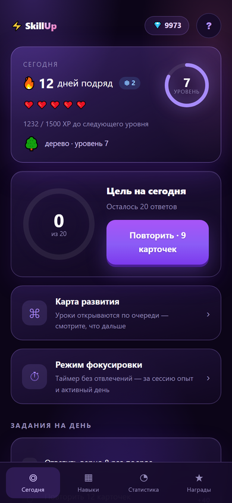
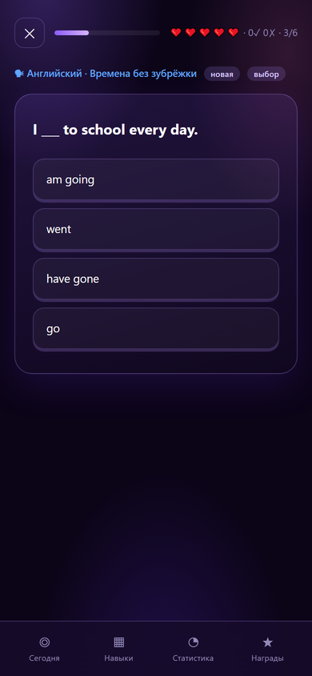

# SkillUp — приложение для развития навыков

Короткие уроки, карточки с интервальным повторением, ежедневные задания,
опыт, гемы, сердечки и недельная лига. Ставится на телефон как обычное
приложение и работает офлайн, прогресс синхронизируется с сервером.

**Открыть: <https://full-emerald.vps.ktk-45.ru/skillup>**

Демо-аккаунт: `demo@eklimiks.ru` / `demo12345`

Аккаунт с гемами для показа: `vip@eklimiks.ru` / `vip12345` — 9 999 гемов,
5 200 очков опыта и серия 12 дней.

## Ссылки для проверки

- **Приложение:** <https://full-emerald.vps.ktk-45.ru/skillup>
- **Репозиторий:** <https://github.com/EKlimiks/skillup>
- **Аккаунт для входа:** `vip@eklimiks.ru` / `vip12345`

## Скриншоты

| Экран «Сегодня» | Вопрос урока |
|---|---|
|  |  |

---

## Что внутри

### 5 навыков и 25 уроков

Английский, программирование, концентрация, деньги и наука. В каждом навыке
пять коротких уроков: немного теории и карточки для закрепления. Следующий
урок открывается после прохождения предыдущего — на экране «Карта» виден
весь путь и текущая цель.

### Интервальное повторение (SM-2)

У каждой карточки есть коэффициент лёгкости. Ответили «легко» — коэффициент
растёт и карточка возвращается реже; ответили «сложно» — чаще. Ошибка
сбрасывает интервал, а карточка возвращается в конец очереди занятия.

```
первый верный ответ   → 1 день
второй верный ответ   → 6 дней
дальше                → интервал × коэффициент лёгкости
ошибка                → интервал сбрасывается
```

Освоенной карточка считается, когда интервал перевалил за 30 дней.

### Геймификация

- **Опыт и уровни** — растут с каждым верным ответом.
- **Гемы** — внутренняя валюта: начисляются за новые карточки, уроки и задания.
- **Сердечки** — как в Duolingo: ошибка отнимает одно, восстанавливаются
  по одному раз в 10 минут.
- **Серия дней** — сколько дней подряд занимались.
- **Достижения** — 21 награда, включая секретные.
- **Лига недели** — рейтинг игроков по опыту за неделю.

### Аккаунт и синхронизация

Прогресс хранится на сервере (Laravel + MySQL), поэтому открывается на
любом устройстве: вошли — и все карточки, уроки, гемы и серия на месте.

---

## Установка на телефон

**iPhone:** откройте ссылку в Safari → «Поделиться» → «На экран Домой».

**Android:** Chrome сам предложит установить, либо меню «⋮» → «Установить приложение».

---

## Структура

| Папка | Что внутри |
|---|---|
| `skillup/` | само приложение: экраны, контент, стили, офлайн-режим, QR |
| `api/` | Laravel 11 API: авторизация, прогресс, лига |

### Стек

- **Фронтенд:** чистый JavaScript без фреймворков, CSS, Service Worker (PWA).
  Состояние — в `localStorage`, синхронизация — через `cloud.js`.
- **Бэкенд:** Laravel 11 + Sanctum + MySQL. Прогресс хранится одним JSON-объектом
  на пользователя, при входе с двух устройств версии объединяются (`SkillupMerger`).

### Файлы приложения

| Файл | Назначение |
|---|---|
| `index.html` | оболочка приложения и нижняя навигация |
| `content.js` | навыки, уроки, карточки, тексты теории |
| `store.js` | состояние, SM-2, опыт, гемы, сердечки, серия, достижения |
| `app.js` | экраны и отрисовка |
| `map.js` | карта развития навыка и «сложные вопросы» |
| `onboarding.js` | знакомство и вход/регистрация |
| `cloud.js` | синхронизация с API |
| `styles.css` | оформление, тёмная и светлая темы |
| `sw.js`, `manifest.json` | офлайн-режим и установка на телефон |

---

## API

Все маршруты — под префиксом `/api`:

```
POST   /auth/register      регистрация
POST   /auth/login         вход
GET    /auth/me            текущий пользователь
POST   /auth/logout        выход

GET    /skillup/progress   прогресс
PUT    /skillup/progress   сохранить прогресс
POST   /skillup/merge      объединить прогресс с другого устройства
GET    /skillup/league     таблица недельной лиги
DELETE /skillup/account    удалить аккаунт и данные
```

Подробнее — в [`api/SKILLUP-API.md`](api/SKILLUP-API.md).

---

## Локальный запуск

```bash
# фронтенд
cd skillup && python -m http.server 8080

# API
cd api && composer install && cp .env.example .env
php artisan key:generate && php artisan migrate
php artisan serve --port=8000
```

Фронтенд обращается к API по тому же origin (`/api`), поэтому для полноценной
локальной проверки удобнее собрать всё за nginx или открыть боевой адрес.

## Проверки

```bash
cd skillup && node audit.mjs      # аудит интерфейса и контента
cd api && node tests/skillup-api-test.mjs
```
